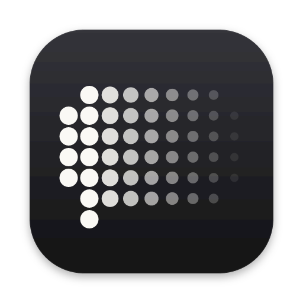

<p align="center">
  
</p>

<h1 align="center">Kreide</h1>
<p align="center">Temporary chats with ChatGPT and Claude, accessible from your desktop.</p>

Kreide is a lightweight desktop app for quick, temporary conversations with ChatGPT and Claude. It stays in your menu bar or system tray, reducing the wait for desktop apps to launch and the need to select Temporary or Incognito mode for every conversation.

Use your existing accounts and subscriptions. No API key is required.

- Global keyboard shortcut to show or hide the window
- Automatic activation and detection of Temporary and Incognito modes
- Unloads idle chats to reduce background memory usage
- Configurable timeout for starting a fresh chat
- Optional always-on-top window

## Usage

Select ChatGPT or Claude and sign in within Kreide. Press ⌘⇧Space on macOS or Ctrl+Shift+Space on Windows and Linux to show or hide the window.

Closing the window keeps Kreide running in the background. Select End chat to end the current conversation, or Quit Kreide from the tray menu to exit. Settings include the default provider, chat timeout, and window preferences.

## Build and run

Install Node.js 22.12+ (or 24+), npm, a stable Rust toolchain, and the [Tauri platform prerequisites](https://v2.tauri.app/start/prerequisites/).

- macOS 14+
- Windows with WebView2
- Linux with WebKitGTK 4.1 and tray support

```sh
npm ci
npm run desktop
```

Build an application bundle:

```sh
npm run desktop:build
```

The unsigned macOS application is generated at `src-tauri/target/release/bundle/macos/Kreide.app`. Build Windows and Linux bundles on their respective platforms.

`npm run dev` previews the local UI at `http://127.0.0.1:1420`.

## Privacy

Kreide stores login data locally and does not save chat transcripts. Select Reset website data to clear a provider's local profile.

Conversations use [ChatGPT Temporary Chat](https://help.openai.com/en/articles/8914046-temporary-chat-in-chatgpt) or [Claude Incognito](https://support.claude.com/en/articles/12260368-use-incognito-chats) and follow the provider's retention policies. Mode detection depends on the English website interface and may require updates when the provider changes its layout.

## Development

```sh
npm test
npm run build
cargo test --manifest-path src-tauri/Cargo.toml
cargo clippy --manifest-path src-tauri/Cargo.toml --all-targets -- -D warnings
```

Kreide uses Tauri 2, TypeScript, and Vite. The local interface is in `src/`, native code in `src-tauri/src/lib.rs`, and the provider adapter in `src-tauri/src/provider-focus.js`. Multiwebview support uses Tauri's `unstable` feature.

## License

[MIT](LICENSE).
